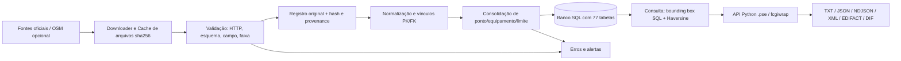

# Fluxo de dados (DFD) e agrupamento ER

O projeto **não requer PostGIS nem funções geoespaciais SQL**. A consulta
geográfica usa *bounding box* em SQL (`core/consultas.py._bbox_clause`) mais
distância Haversine na aplicação (`core/geo.py`).

Etapas no código: `coletor/base.py` (cache imutável sha256, staging,
snapshot atômico, `SAVEPOINT` por registro), `coletor/fontes/normalizacao.py`
(inserção no modelo canônico), `core/db.py` (conexão SQLite com FK=ON, init
do schema), `core/consultas.py` (leitura), `web/nucleo.py` + `web/api.pse`
(CGI), `core/serializers/` (formatos de saída).

## Agregados relacionais principais

O schema canônico tem **77 tabelas (T01..T77)**, definidas em
`tools/build_schema.py` e materializadas em `sql/schema.sqlite.sql` (SQLite)
e `sql/schema.postgres.sql` (Postgres). As tabelas efetivamente existentes,
por agregado:

- **Cadastro:** `UF` (T01), `MUNICIPIO` (T02), `TIPO_VIA` (T03), `VIA` (T04),
  `VIA_UF` (T05), `TIPO_ORGANIZACAO` (T07), `ORGANIZACAO` (T06),
  `PAPEL_ORGANIZACAO` (T08) e os domínios de classificação T09..T22
  (`TIPO_RADAR`, `FUNCAO_EQUIPAMENTO`, `TECNOLOGIA_MEDICAO`,
  `SITUACAO_OPERACIONAL`, `MODALIDADE_FISCALIZACAO`, `TIPO_MEDICAO`,
  `SENTIDO`, `CATEGORIA_VEICULO`, `SITUACAO_OPERACAO`,
  `RESULTADO_VERIFICACAO`, `TIPO_VERIFICACAO`, `TIPO_DOCUMENTO`,
  `TIPO_IDENTIFICADOR`, `QUALIDADE_POSICAO`).
- **Localização:** `POSICAO_GEOGRAFICA` (T23), `ENDERECO` (T24),
  `PONTO_FISCALIZACAO` (T25), `PONTO_ORGANIZACAO` (T26),
  `FAIXA_FISCALIZACAO` (T27), `LIMITE_VELOCIDADE` (T28),
  `REGIME_FISCALIZACAO` (T29).
- **Instrumento:** `MODELO_EQUIPAMENTO` (T33), `EQUIPAMENTO` (T34),
  `INSTALACAO` (T35), `INSTALACAO_FAIXA` (T36),
  `VERIFICACAO_METROLOGICA` (T46). *(Não existe a tabela
  `faixa_medicao_equipamento` citada no modelo de referência: a ligação
  instrumento↔faixa é feita por `INSTALACAO_FAIXA` — T36 — e pelos vínculos
  `VINCULO_REGISTRO_*`.)*
- **Operação portátil/pontual:** `OPERACAO_FISCALIZACAO` (T37),
  `OPERACAO_EQUIPAMENTO` (T38), `OPERACAO_FAIXA` (T39),
  `OPERACAO_RECORRENCIA` (T40), `RECORRENCIA_DIA` (T41),
  `TRECHO_ELEGIVEL` (T30), `TRECHO_VERTICE` (T32), `TRECHO_MUNICIPIO` (T31).
- **Proveniência:** `FONTE` (T54), `RECURSO_FONTE` (T56),
  `ARTEFATO_COLETA` (T57), `REGISTRO_FONTE` (T59), `VINCULO_REGISTRO_PONTO`
  (T63), `VINCULO_REGISTRO_EQUIPAMENTO` (T64), `VINCULO_REGISTRO_OPERACAO`
  (T65), `VINCULO_REGISTRO_TRECHO` (T66), `VINCULO_REGISTRO_VERIFICACAO`
  (T67), `IDENTIFICADOR_EXTERNO` (T42), `IDENTIFICADOR_PONTO` (T43),
  `IDENTIFICADOR_EQUIPAMENTO` (T44), `IDENTIFICADOR_OPERACAO` (T45).
- **Histórico:** `EXECUCAO_COLETA` (T58), `SNAPSHOT_PUBLICADO` (T61),
  `SNAPSHOT_RECURSO` (T62), `ERRO_VALIDACAO` (T60), `ALERTA_OPERACIONAL`
  (T74), `REGRA_DEDUPLICACAO` (T68), `CANDIDATO_DUPLICIDADE` (T69),
  `DECISAO_DUPLICIDADE` (T70).
- **Contexto:** `OBSERVACAO_TRAFEGO` (T53), `COBERTURA_FONTE` (T55),
  `DOCUMENTO` (T47), `DOCUMENTO_PONTO` (T48), `DOCUMENTO_EQUIPAMENTO` (T49),
  `DOCUMENTO_VERIFICACAO` (T50), `DOCUMENTO_OPERACAO` (T51),
  `DOCUMENTO_TRECHO` (T52), `CATALOGO_CAMPO` (T71), `VALOR_OBSERVADO` (T72),
  `DECISAO_VALOR_CANONICO` (T73), `NATUREZA_FONTE` (T75),
  `LICENCA_DADOS` (T76), `RECURSO_LICENCA` (T77).

PK/FK/UNIQUE/CHECK/NOT NULL e tipos lógicos estão declarados na **fonte única**
`tools/build_schema.py`, que gera `sql/schema.sqlite.sql` (SQLite) e
`sql/schema.postgres.sql` (Postgres). O schema é carregado por
`core.db.init_db`. **Tabelas previstas para extensões futuras não implicam
que todo o seu processamento esteja implementado nesta versão** (ver
`docs/LIMITACOES_E_STATUS.md`).
