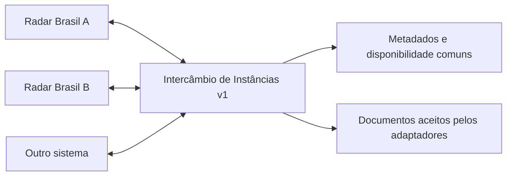

# Protocolo de Intercâmbio de Instâncias, versão 1

O protocolo é genérico: transporta identidade, capacidades, disponibilidade e
lotes de documentos. Não exige Radar Brasil, Python, SQLite ou arquivos `.pse`.
O **TRASEIRO DE URSO** é o adaptador de radares deste protocolo.

A implementação reutilizável está em [`core/intercambio.py`](../core/intercambio.py),
sem dependências do projeto: pode ser copiada para outro programa Python. Outros
programas podem implementar o contrato em qualquer linguagem usando HTTPS e JSON.
O [JSON Schema](../web/resources/intercambio-v1.schema.json) descreve os envelopes;
em uma instalação, também fica público em `resources/intercambio-v1.schema.json`.



## Uma operação, endpoint livre

Cada instância anuncia `api_url`, a URL **completa da operação de troca**. Exemplos:

- `https://sistema.exemplo.org/services/exchange`
- `https://radar.exemplo.org/openclaw/radar/api.pse?rota=%2Fapi%2Fv1%2Fintercambio%2Ftrocar`

O cliente faz POST nessa URL, sem acrescentar caminhos específicos do Radar.
Uma consulta leva os dados enviados e devolve os dados solicitados. Há no máximo
uma consulta por par em cada rodada, sem abrir outra requisição por página ou
por direção. Os lotes restantes ficam para as próximas rodadas.

Cabeçalhos:

```text
Content-Type: application/json
X-Interchange-Info: <JSON da identidade em UTF-8, codificado em base64url com padding>
Authorization: Bearer <token, somente quando a rede exigir>
```

O cabeçalho público tem limite de 8192 caracteres. Nunca inclua configuração
inteira, caminhos locais, senhas, tokens, contatos, cookies ou chaves nesse bloco.

Identidade do consultante (exemplo):

```json
{
  "uuid": "c6b97d4c-2a27-48cd-b572-e9acec2148df",
  "nome": "Instância de exemplo",
  "aplicacao": "Sistema externo de mobilidade",
  "api_url": "https://sistema.exemplo.org/services/exchange",
  "protocolo": {"nome": "intercambio-instancias", "versao": 1},
  "capacidades": {"tipos_evento": ["radar.v1"]},
  "configuracao": {
    "intervalo_segundos": 300,
    "lote": 100,
    "max_bytes": 2097152,
    "parada_programada": false,
    "parar_em_segundos": 0,
    "retornar_em_segundos": 0,
    "anuncio_id": null
  }
}
```

O UUID persiste entre reinícios; cada instalação tem o seu. Não copie a identidade
para criar uma instalação diferente. A identidade informa origem lógica;
a autorização depende do modo de acesso da rede, e não do nome da aplicação.

Pedido:

```json
{"eventos": [], "depois": 0, "limite": 100}
```

Resposta normal:

```json
{
  "sucesso": true,
  "rede": {
    "consultante": {"...": "identidade completa recebida"},
    "consultado": {"...": "identidade completa deste servidor"}
  },
  "resultado": {
    "recebidos": 0,
    "novos": 0,
    "repetidos": 0,
    "eventos": [],
    "cursor": 0,
    "mais": false,
    "instancias": []
  }
}
```

Os objetos com `...` são abreviações de documentação: na resposta real, são os
blocos completos. `instancias` contém identidades públicas descobertas, sem
segredos ou cursores locais. O catálogo cabe no orçamento de bytes; em redes
grandes a ordem gira para permitir descoberta gradual.

## Intervalos independentes

`intervalo_segundos` é o **mínimo para consultar quem publicou o valor**:

- A anuncia 300; B pode consultar A a cada 300 segundos ou mais.
- B anuncia 60; A pode consultar B a cada 60 segundos ou mais.

Não se usa o maior dos dois intervalos. O limite de A não altera a frequência
com que A pode consultar B. Uma chamada já em andamento por par é suficiente.
O recebimento antes do prazo devolve `resultado.adiado=true` e os blocos atuais;
não recebe nem confirma o lote. O chamador mantém seus cursores e reagenda pela
configuração nova do consultado. Não conta esse adiamento como falha.

A agenda pode consultar menos frequentemente por limites locais de execução.
No Radar o cron acorda a cada minuto: um mínimo menor que 60 segundos não obriga
a criar um serviço permanente ou fazer chamadas a cada segundo.

## Parada anunciada e retorno

Os prazos anunciados são segundos restantes **no momento da mensagem**:

- `parada_programada=false`: online, dois prazos zerados e `anuncio_id=null`.
- `true`, parar em 3600 e retornar em 7200: para daqui a uma hora, volta daqui
  a duas horas, contadas a partir da mensagem.
- `true`, parar em 0 e retornar em 0: já está parado, sem previsão de retorno.

`anuncio_id` identifica a programação. O produtor ancora a contagem uma vez e
reduz os prazos nas mensagens seguintes; não reinicia o relógio a cada consulta.
O consumidor calcula datas locais a partir dos prazos recebidos, sem precisar
confiar no relógio absoluto do outro servidor.

Durante a janela de parada, o par fica pausado, não acumula falhas e não é sondado.
Se o próprio servidor ainda responder, informa `resultado.pausado=true`, os
blocos atuais e não processa o lote. Um retorno positivo retoma as consultas
automaticamente após o prazo. Um retorno zero mantém a pausa indefinidamente.

**Reciprocidade:** instância declarada parada não pode consultar outras instâncias.
O cliente local interrompe as saídas e o receptor recusa um consultante cujo
bloco ainda declara parada já iniciada. Para voltar sem retorno programado,
o administrador cancela a parada e zera os dois prazos; o servidor volta a
aceitar consultas e anuncia esse estado. Isso também libera suas saídas.

## Eventos, confirmações e prevenção de eco

```json
{
  "uuid": "2984c66c-9fe2-42ed-8eb1-eef2e7aa3144",
  "origem": "c6b97d4c-2a27-48cd-b572-e9acec2148df",
  "tipo": "radar.v1",
  "chave": "equipamento-604",
  "revisao": 1,
  "acao": "publicar",
  "documento": {"latitude": -24.9556, "longitude": -53.4552, "velocidade_geral": 80}
}
```

O envelope é genérico. O adaptador da aplicação define o documento. Tipos são
negociados em `capacidades.tipos_evento`; este adaptador aceita `radar.v1` e
`fonte-coleta.v1`. Outro sistema pode anunciar seus próprios tipos; não se envia
um tipo que o destino não anunciou. Um sistema sem tipos em comum ainda pode
negociar identidade/disponibilidade, sem receber documentos incompatíveis.

Identidade da entidade: `(origem, tipo, chave)`. Revisão positiva e crescente.
O UUID do evento e seu conteúdo são imutáveis. Repetir exatamente o mesmo evento
confirma recebimento sem criar outra cópia. Reutilizar UUID/revisão com conteúdo
diferente é conflito, não uma edição. Revisão antiga recebida fora de ordem
permanece no diário, mas não substitui a versão atual. `retirar` usa documento
vazio e é um evento persistente, nunca apagamento do histórico.

Cada servidor mantém seu próprio diário sequencial. `depois` é o cursor do
**diário do consultado**, não a revisão do radar. O consultante só persiste esse
cursor depois de gravar duravelmente o lote recebido. O cursor de envio só
avança quando `recebidos` confirma o lote inteiro. Perda de resposta/ACK causa
reenvio idempotente. Filtrar tipos não suportados pode retornar zero eventos e
um cursor maior: os itens examinados já foram percorridos. Novas capacidades
reabrem o envio do histórico para permitir preenchimento retroativo.

A → B → C → A preserva UUID/origem/revisão; C não recria o evento como se fosse
seu. A camada de dados decide que entidades precisam de revisão humana; receber
um evento ou uma declaração de origem não torna seu conteúdo oficial.

O limite de bytes inclui os dados e os metadados. O adaptador limita documentos
a 32 KiB e lotes/catálogos ao orçamento anunciado. Payload inválido ou conflito
recusa o lote inteiro. Não se altera cursor após recusa. Instâncias e eventos
desconhecidos não devem causar execução de código recebido.

Erros usam HTTP 401 (token), 403 (bloqueio/consultante parado), 409 (conflito),
413 (tamanho), 422 (contrato), 429 (capacidade) ou 503 (desativado/indisponível),
com `sucesso=false` e objeto `erro`. Não há ACK de dados numa resposta de erro,
adiamento ou pausa.

## Cliente independente em Python

Copie `core/intercambio.py` para `intercambio.py` no seu projeto:

```python
from intercambio import consultar, proxima_consulta
from datetime import datetime, timezone

# minha_identidade tem o mesmo formato do exemplo acima.
# Primeiro contato sem documentos: descobre tipos, intervalo e limites remotos.
resposta = consultar(url_completa_do_destino, minha_identidade, token=token_da_rede)
remoto = resposta["rede"]["consultado"]
quando_tentar_de_novo = proxima_consulta(remoto, datetime.now(timezone.utc))

# Seu sistema grava duravelmente os eventos antes de salvar resultado.cursor.
# Nas proximas rodadas, envia apenas tipos aceitos em remoto.capacidades.
```

O helper usa apenas biblioteca padrão, HTTPS e JSON; não abre banco nem lê
configuração do Radar. O sistema chamador decide sua persistência, agenda,
adaptadores, autorização e validação dos documentos.

O receptor pode reutilizar `decodificar_info`, `validar_pedido` e `responder` do
mesmo módulo. Esses helpers não executam gravações: o sistema hospedeiro decide
a autenticação, os callbacks de persistência e os tipos de documento suportados.
