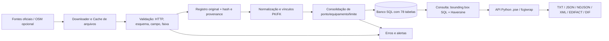

# Fluxo de dados (DFD) e agrupamento ER

O projeto **não requer PostGIS nem funções geoespaciais SQL**.

## Agregados relacionais principais

- Cadastro: `uf`, `municipio`, `via`, `via_uf`, `organizacao`, domínios de classificação e seus papéis.
- Localização: `posicao_geografica`, `ponto_fiscalizacao`, `endereco`, `faixa_fiscalizacao`, `limite_velocidade`, `regime_fiscalizacao`.
- Instrumento: `equipamento`, `modelo_equipamento`, `instalacao`, `instalacao_faixa`, `faixa_medicao_equipamento`, `verificacao_metrologica`.
- Operação portátil/pontual: `operacao_fiscalizacao`, `operacao_equipamento`, `operacao_faixa`, `operacao_recorrencia`, `recorrencia_dia`, `trecho_elegivel`, `trecho_vertice`, `trecho_municipio`.
- Proveniência: `fonte`, `recurso_fonte`, `artefato_coleta`, `registro_fonte`, `vinculo_registro_*`, `identificador_externo`, `identificador_*`.
- Histórico: `execucao_coleta`, `snapshot_publicado`, `snapshot_recurso`, `erro_validacao`, `alerta_operacional`, `regra_deduplicacao`, `candidato_duplicidade`, `decisao_duplicidade`.
- Contexto: `observacao_trafego`, `documento`, `documento_*`, `catalogo_campo`, `valor_observado`, `decisao_valor_canonico`, `natureza_fonte`, `licenca_dados` e `recurso_licenca`.

PK/FK/CHECK/UNIQUE e tipos lógicos estão declarados em `radarbrasil/schema.py`. O arquivo `docs/schema_sqlite.sql` contém a representação física para SQLite; outros dialetos são gerados pelo SQLAlchemy no primeiro `init`, com eventuais adaptações de driver. Tabelas previstas para extensões futuras não implicam que todo seu processamento esteja implementado nesta versão.
